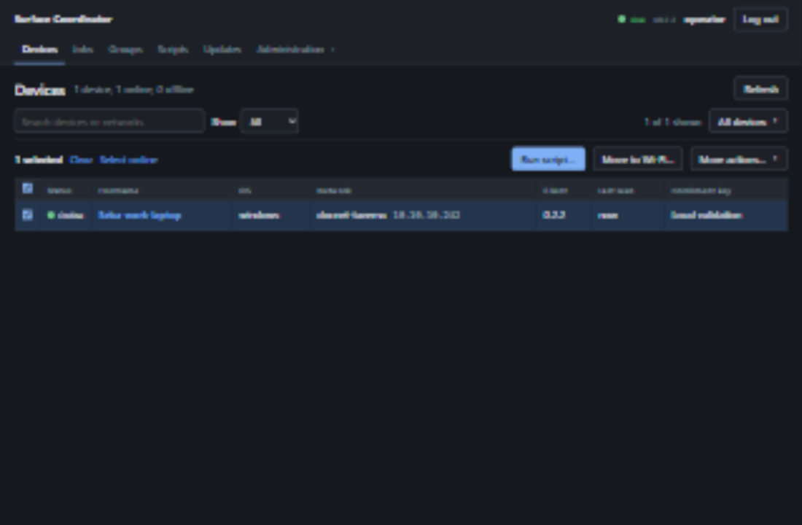
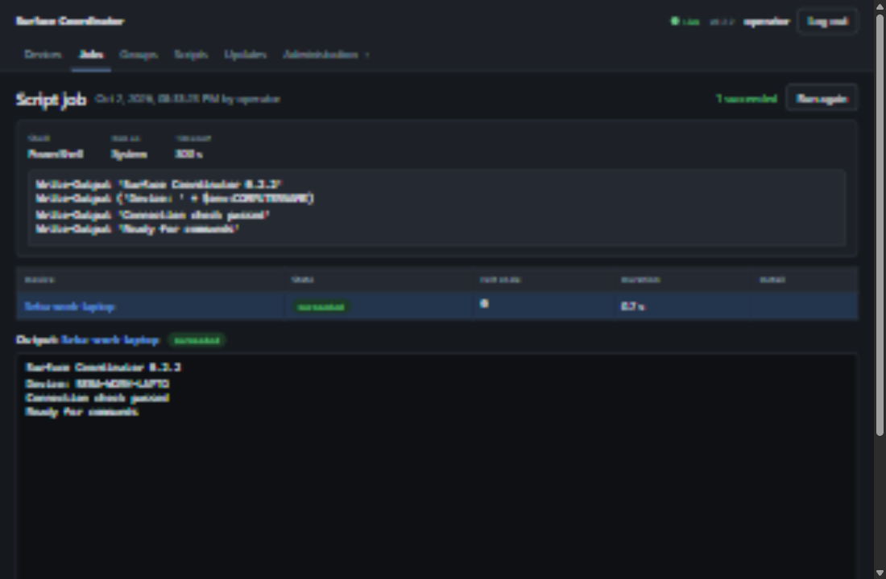

# Version 0.2.2 validation

Validated on 2 October 2026 from `C:\coding\surface-coordinator` on
`Seba-work-laptop`, Windows x86_64. Linux checks ran in local Docker Desktop.
This is a locally built release candidate. The live coordinator and installed
Surface clients were not upgraded or reconfigured during this work.

## What changed

- A coordinator outage no longer causes automatic discovery to replace an
  active, connecting or unknown Wi-Fi connection. Windows joins use the actual
  connection notification instead of forcing a disconnect or trusting a stale IP.
- Reconnects can interrupt a pending handshake. Socket reads remain responsive
  during writes, and stalled writes/shutdown have deadlines.
- Cancellation persists across client disconnect and server restart. A silent
  Wi-Fi handoff is shown as unconfirmed, and a later actual result can resolve it.
- Password work is bounded and happens outside the SQLite lock. Session
  revocations reach already-open event sockets. Database waiters no longer pile
  up blocking threads, and job-history/expiry queries have indexes.
- The UI batches script output, limits request waits, detects dead idle event
  sockets, exposes stale state and retry controls, and fits smaller screens.
- Hotspot operations reconcile Windows state without restarting an unchanged
  network, respect ownership on stop, and synchronize key revocations.
- Release workflows test before publishing and use locked dependencies. The
  upload script locates the correct compiled artifact and preserves secret state.

## Automated checks

| Check | Result |
|---|---|
| `cargo test --locked --workspace` on Windows | 499 passed; 2 opt-in hardware tests ignored |
| `cargo clippy --locked --workspace --all-targets -- -D warnings` | Passed |
| `npm test` | 374 passed in 23 files |
| TypeScript and Vite production build | Passed |
| `npm audit --omit=dev` | No reported production dependency vulnerabilities |
| `cargo test --locked` inside Linux builder | 363 passed |
| Windows optimized binaries | Coordinator, client, manager and signing tool built |
| Linux runtime container | Non-root UID 10001; health 200/version 0.2.2; embedded UI 200; authenticated API works |
| Client artifact signature | Signed using existing project key; verified against committed public key |
| Windows NSIS installer | Version 0.2.2; archive integrity passed |
| `git diff --check` | Passed |

The two ignored Windows tests change real audio settings and scan real Wi-Fi.
They now require deliberate opt-in on a test device. Other Windows tests include
real PowerShell execution. Linux tests exclude Windows platform behavior and
the Tauri manager.

## Release-binary integration and browser checks

`scripts/prod-validation.ps1 -KeepRunning` used a fresh accounts-mode database,
one real Windows console client and `127.0.0.1:18081`. Hotspot discovery was
disabled for this test client. It verified:

1. Unauthenticated device access is refused.
2. A real client enrolls and connects.
3. PowerShell output and its successful result arrive.
4. A running script cancels.
5. An offline job stays queued and executes after reconnect with the same ID.
6. A running job survives coordinator restart and replays output and its result.

Browser checks used the embedded production UI through the T3 collaborative
preview: login, select online, compose/submit a real script, completed output,
desktop and 390px layouts, and stale-state feedback during a server restart.
Tables scroll within their container on small screens. The document itself does
not overflow horizontally.

Local response measurements, five script samples after builds finished:

| Measurement | Observed range |
|---|---|
| Job creation response, browser clock | 5.9–17.4 ms |
| Creation to client acknowledgment, coordinator timestamps | 6–19 ms |
| PowerShell execution after acknowledgment | 692–717 ms |
| Complete job observed by browser, including 20 ms polling | 720.7–761 ms |
| Device-list API, 40 requests | Median 0.6 ms; 95th percentile 0.9 ms |

These are localhost measurements with one client, not fleet-scale or WAN
guarantees. An earlier run during concurrent compilation took 0.9–3.3 seconds
per complete PowerShell job. Wi-Fi association/DHCP and Windows process startup
have their own latency; fast command dispatch does not make those instantaneous.

Raw local logs and the original integration report are under `demo-data/`.
The portable delivery includes the report and separate responsiveness samples.
Temporary account credentials remain only in the ignored local `access.json`;
they are not included in delivery artifacts.

## Screenshots

These are captures of the actual 0.2.2 optimized application with local test
data, not the live production fleet. The browser follows the existing dark theme.

[Phone-sized devices](screenshots/0.2.2/mobile-devices.png) ·
[Phone-sized job output](screenshots/0.2.2/mobile-job.png)

## Real Surface network-preservation check

The previously enrolled Surface **User**, `10.10.10.186`, was online on 0.2.1.
A diagnostic job through its existing coordinator ran the verified 0.2.2 binary
from a temporary folder as `NT AUTHORITY\SYSTEM`, without replacing or stopping
the installed service. A temporary artifact server on `network-vm`
(`10.10.10.110`) was removed after the check.

The temporary client had normal hotspot discovery enabled, a separate identity,
and an intentionally unreachable coordinator. Windows withheld its current SSID.
On the **Marvell AVASTAR Wireless-AC Network Controller** over **72.2 seconds**:

- 35 adapter/address samples, zero connection failures.
- Six logged decisions to preserve the current connection with `ssid=None`.
- Zero hotspot join attempts and zero recorded WLAN disconnect events.
- Installed service remained Running, and the device was online afterward.

The diagnostic job succeeded with exit code 0. Its temporary client process and
downloaded executable were removed; small diagnostic state/logs remain in its
temporary folder. The delivery evidence includes the result. This validates
the main preservation regression on a real Surface; it does not validate an
intentional move to another Wi-Fi or a service installation/update.

## Deployment and remaining checks

Back up the coordinator database before upgrading: 0.2.2 adds a migration for
durable cancellation and indexes. Restore the matching database backup and
previous binary together if rolling back. Install the fixed client on each
Surface; upgrading only the server does not correct an old client's networking.

No test here moved the Surface's Wi-Fi, installed a service or replaced its
installed client. Intentional Wi-Fi moves with Location disabled, DHCP timing,
service installation/update, and failed-handoff recovery remain release gates
in [manual-tests.md](manual-tests.md). Hardware
power/settings and macOS/Linux desktop-manager behavior also remain unverified.

The Manager installer is not Authenticode-signed. Manager self-update is disabled
because its separate updater public key has not been configured. The release
workflow requires its signing setup before publishing. The client update artifact
has the project's existing signature and can be uploaded when deployment is
intended.

The live coordinator previously had automatic rollout enabled. Uploading a new
client there can trigger fleet updates, so this work did not publish a release
or upload to production. Use a single test Surface before enabling broad rollout.
See [usage instructions](usage.md) and the [deployment guide](../deploy/README.md).
