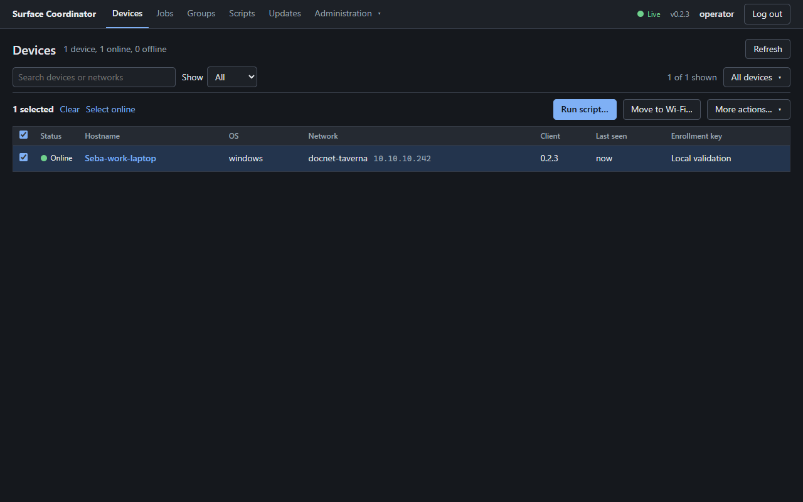
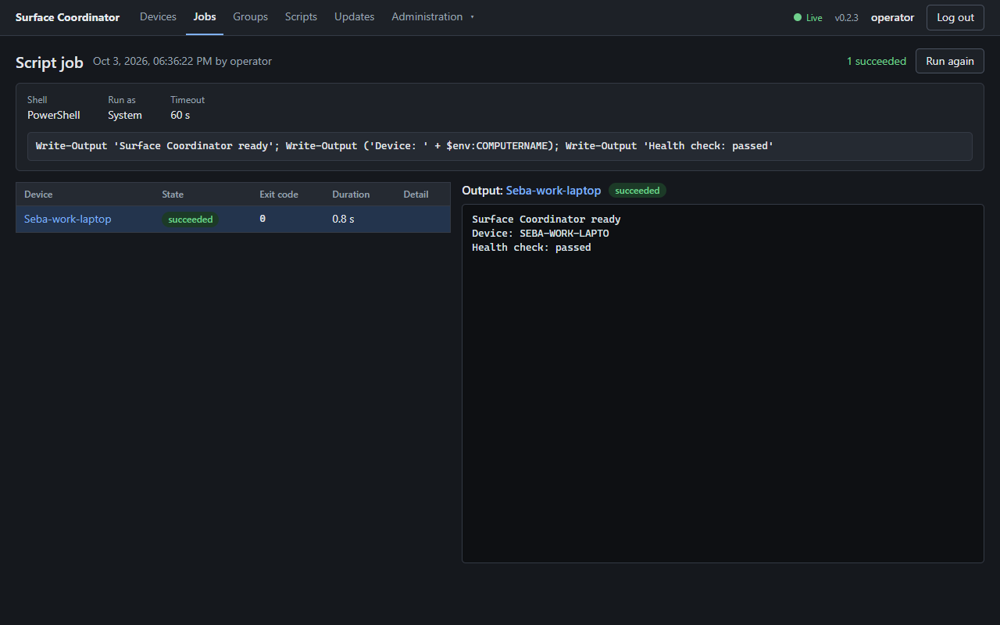
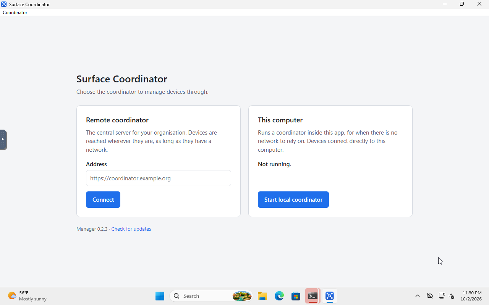

# Version 0.2.3 validation

Validation runs from `C:\coding\surface-coordinator` on **Seba-work-laptop**.
Windows installation tests use the disposable local VM **SC-VALIDATION**;
Linux server tests use Docker Desktop. The live coordinator and installed
Surface clients have not been upgraded by these checks.

Release validation and test cleanup completed on 3 October 2026. The earlier
[0.2.2 report](validation-0.2.2.md) remains a record of the first candidate.

## Changes

- Preserve active, connecting and unknown Wi-Fi connections during coordinator
  outages, including when Windows Location permissions hide the SSID.
- Keep reconnect, cancellation, output replay and UI connection status responsive.
  Script output is batched for rendering; requests and socket writes have deadlines.
- Bound new in-flight jobs to 16 per device. Additional jobs stay durably queued
  in SQLite. Cancellation bypasses admission, and a confirmed result frees a slot.
  Already-sent jobs from an older version can exceed the new admission limit.
- Commit ready database operations in groups while retaining SQLite's FULL
  synchronous durability. Indexed queries avoid scanning large delivery backlogs.
  Persistence failure reconnects the client so retained results can be replayed.
- Append live output in SQLite instead of rewriting the full accumulated output
  for every chunk. Job details load output for the selected device only; changing
  targets or reconnecting repairs the selected stream from a fresh snapshot.
- Build standalone Windows executables with the C runtime included, so a clean
  Windows installation does not need an extra Visual C++ runtime package.
- Allow Windows' asynchronous Wi-Fi retry to succeed within the existing
  30-second join deadline. A failed notification no longer ends a move before
  Windows connects; a later selection of another network remains protected.
- Preserve native HRESULT results in the Windows audio COM interfaces, including
  the explicit error when the machine has no default audio output.
- Harden service installation paths and permissions. An unsafe existing folder,
  directory junction or mismatched registered service is refused.
- Validate signed update candidates by starting their version command before
  replacement. Keep the previous binary until the new service authenticates;
  roll back if it cannot confirm within three minutes. Persist update state
  before replacement and the final result before deleting recovery files.
- Configure the Manager's separate signed updater, verify package signatures and
  signed versions during packaging, and restore the local coordinator if an
  update installer cannot be launched.

## Automated validation

| Check | Result |
|---|---|
| Full Windows workspace tests | 547 passed; 2 opt-in hardware tests ignored |
| Full Windows workspace all-target clippy | Passed with warnings denied |
| UI tests | 383 passed across 26 files |
| TypeScript and production UI build | Passed |
| Linux coordinator, core, protocol and release-tool tests | 274 passed |
| Client installer tests, including native default-folder compatibility | 18 passed |
| Client ledger tests | 12 passed |
| Client update tests | 25 passed |
| Full client suite after final audio and Wi-Fi fixes | 208 passed; 2 opt-in hardware tests ignored |
| Coordinator storage migration and selected-output API | Included in the full workspace suite |
| Client and coordinator-core all-target clippy | Passed with warnings denied |
| Manager package verification | Valid signature/version accepted; wrong key, wrong version and modified bytes rejected |

The two ignored tests intentionally require opt-in before touching actual audio
settings or scanning Wi-Fi. Native lifecycle and performance results are
recorded below.

## Windows install and update checks

The VM is Windows 11 Enterprise Evaluation, build 26300, with 4 vCPUs and 4 GB
RAM. Its console is exposed only on the execution host's loopback interface.
The service test runner executes as SYSTEM; desktop checks use the signed-in
Validator account. No daily-driver service or application installation is used.

Client update fixtures use the final source with disposable versions 90.0.1 and
90.0.2 and a test signing key. Manager updater fixtures use a separate app identity,
test key and a loopback update endpoint. These fixtures are never published and
their keys are not included in the delivery.

Manager fixture checks passed: per-user installation, refusal of tampered bytes
and a mismatched signed version, recovery after an authenticated unsupported
installer format, successful signed NSIS update with automatic restart, and
manual rollback. A saved group remained present after both update and rollback.

A deliberately malformed MZ executable stalled in Windows' installer launch
path for several minutes without a visible error dialog. Its cause was not
established; that case is not counted as passed. Only the owned test process was
terminated, and no Windows security prompt was bypassed. The genuine signed
NSIS update subsequently completed successfully.

The native client lifecycle passed all 48 checks with no cleanup errors. It
covered installation as an automatic LocalSystem service, restart/reinstall
with the same device identity, real System and logged-in-user PowerShell output,
interactive app launch under the correct user, timezone application, signed
update, and refusal of tampered updates. Locked configuration and executable
replacement failures restored the original files.

Injected pending-update markers exercised both recovery paths through the real
SCM: three unconfirmed starts caused rollback on the fourth start, and one
unconfirmed start rolled back after 180.958 seconds. Both restored the exact
previous executable, retained the device identity, restarted automatically and
executed a fresh job. The test removed its service and dedicated directories.
A first attempt stopped because the harness treated the intentional rollback
exit as a startup error; the corrected observation required exact restored bytes
and successful automatic recovery before passing.

The VM has no built-in brightness device; the expected native hardware error
was verified. It also has no default audio endpoint. An explicit native audio
test under its logged-in user passed the dedicated missing-device error path.
Changing real volume or mute was not exercised on that VM.

The exact signed shipping client was then installed separately and the VM was
rebooted. All eight post-boot checks passed: automatic LocalSystem startup,
the same device identity and executable hash, disabled hotspot discovery for
the isolated trial, and clean uninstall/task removal. The 48-check updater
fixtures preceded only the final audio and Wi-Fi changes; their installation
and update code is unchanged.

The final production Manager installer passed installation and startup on that
same clean VM. Its installed payload matched the packaged executable, accounting
for Tauri's three-byte NSIS bundle marker. The window fit the 1280×800 display,
the embedded coordinator showed Live/version 0.2.3, and closing Manager removed
its processes and released its ports. The installer and payload checksums are
recorded separately in the native evidence.

## Server upgrade and rollback

The rehearsal starts with the locally available 0.2.0 server image in a fresh
volume. It creates a real account, key, group, saved script, enrolled console
client and completed job output before stopping the server and backing up the
whole data directory. The previous image and its backup are retained together.

All 33 checks passed for 0.2.0 → 0.2.3 → restored 0.2.0. The existing session,
fresh login, account, key, group, saved script, device identity and completed job
output survived the upgrade. The real 0.2.3 Windows console client executed
PowerShell jobs after upgrade and after rollback. Restoring the old backup also
correctly removed post-upgrade changes. All rehearsal containers, volumes,
clients and the loopback listener were removed afterward.

The database moved from schema 6 to 10, then back to schema 6 by restoring the
stopped-server backup. SQLite integrity checks passed before upgrade, after
upgrade and after restore. Historical output also passed both the full-job API
and the new selected-target output API; metadata-only reads omitted output.

## Performance and browser checks

The fleet harness authenticates simulated devices through the real protocol,
streams sequenced output, reconnects, cancels jobs and polls the API while work
is in progress. Simulated device execution measures coordinator throughput;
it does not model Windows process startup or physical Wi-Fi association.

The optimized Windows binaries also passed a separate real-client integration
run: authentication, actual PowerShell output, cancellation, offline queuing,
identity-preserving reconnect and output/result replay across coordinator
restart. Browser checks used the built-in production UI to sign in, select the
online device, submit a script and inspect its completed output. At 390 px,
device and job pages did not overflow the document horizontally.

The final quiet-host run used 300 simulated devices. It verified 6,600 short-job
targets plus two streamed-output jobs with 300 targets each. Every final state
and output matched both the API and UI events, then matched SQLite after the
coordinator stopped. There were no unexpected disconnects, duplicate executions,
HTTP failures or output mismatches.

| Measurement | Final result |
|---|---|
| API reads during short-job workload | 17.94 ms median; 97.07 ms p95; 280.11 ms p99 |
| Job submission | 22.74 ms median; 55.43 ms p95 |
| Job dispatch acknowledgement | 48 ms median; 163 ms p95 |
| Active fleet cancellation | 143 ms |
| 300-device sustained output | 54,000 chunks × 512 bytes, all persisted and acknowledged |
| Sustained output completion | 47.077 s maximum for a nominal 45 s stream |
| Delay from final result send to acknowledgement | 593 ms maximum |
| Actual durable output throughput | 1,146 chunks/s |
| Coordinator peak memory during short jobs | 79 MiB resident |
| Coordinator CPU during short jobs | 1.77% of the 16-logical-CPU host |

The disposable VM and other builds were paused for these measurements. The
sender actually emitted its sustained stream over about 46.5 seconds; the
throughput figure uses observed times. Fresh-database, loopback results do not
establish long-history or physical-network performance.

During the second stream, the actual production UI fetched about 70 KB of job
metadata and only the selected device's output (about 85–92 KB). Filtering the
fleet changed the DOM in 14 ms; restoring all rows took 22 ms; selecting another
output took 11 ms. No browser main-thread tasks longer than 50 ms were recorded
in the 65-second observation. These are observations from one browser run,
not guarantees of paint latency.

With the final binaries, five actual PowerShell jobs on the local Windows
console client completed in 823–996 ms, with dispatch acknowledgements in
3–5 ms. Device API reads measured 0.61 ms median and 0.76 ms p95. Process startup
and network conditions still affect real-device completion time.

A final UI-only change resets document scroll when opening a new page. The
fleet and Linux database checks cover the same backend as the shipped build.
The rebuilt Windows and Linux binaries served the final
`index-DRGtm6BB.js` asset. A real mobile-width submission from scroll position
276 opened its completed job at position 0 with the title visible, correct
PowerShell output and no horizontal document overflow. The single-device
screenshots below were recaptured from that final build.

## Screenshots

These show the actual optimized 0.2.3 application with isolated validation data.
They are not captures of the live production fleet.
The desktop and phone device/job captures were refreshed at native resolution
after restoration, using the same shipping binaries. The temporary local
client and coordinator were stopped afterward.

[Phone-sized device list](screenshots/0.2.3/mobile-devices.png) ·
[Phone-sized job view](screenshots/0.2.3/mobile-job.png) ·
[300-device fleet](screenshots/0.2.3/fleet-300.png) ·
[Output during the fleet test](screenshots/0.2.3/fleet-output.png)

[Manager with its local coordinator](screenshots/0.2.3/manager-local.png)

## Physical Surface evidence

The earlier 0.2.2 candidate was run temporarily as SYSTEM on Surface **User**
with normal discovery enabled and an unreachable coordinator. Over 72.2 seconds
there were 35 successful adapter/address samples, six logged preservation
decisions with a hidden SSID, zero hotspot joins and zero recorded WLAN
disconnect events. The installed service remained running and was not replaced.
See the [original evidence](validation-0.2.2.md#real-surface-network-preservation-check).

The final 0.2.3 client was also run under a separate identity on Surface User,
using the actual laptop hotspot and the default automatic radio band. During
the deliberate coordinator outage it preserved the manually connected network.
An explicit Wi-Fi job then reached the hotspot in 7.234 seconds, and a real
System script succeeded through Manager. Manager's move-to-current-Wi-Fi action
returned it to docnet-taverna; a fresh destination connection was observed in
1.329 seconds and another real System script succeeded there.

An earlier 2.4 GHz compatibility run independently verified the same flow.
Its 60-second preservation window contained 29 successful adapter/address
samples and no WLAN disconnect events. The initial harness incorrectly treated
the normal no-address interval during a requested handoff as fatal; it was
corrected before the completed transfer runs. Native evidence also exposed a
transient failed Windows completion followed by successful association, which
led to the final client's bounded retry-observation fix.

The laptop hotspot is off and its original settings are restored. The transfer
harness initially failed during cleanup: its network-reconnection command did
not succeed, and remote service administration was denied. The user subsequently
restarted the original service. At 16:34 UTC on 3 October, a fresh System job
confirmed the original 0.2.1 client online on docnet-taverna at 10.10.10.186,
with automatic service startup and the exact pre-test executable SHA-256.

Cleanup then removed the inactive test hotspot profile, both scheduled test
tasks and all four temporary test directories, after saving their evidence.
The original service process stayed running throughout cleanup. A separate
System job verified the network, installed binary and absence of test leftovers.
The original transfer report retains its failed cleanup result; the bundle's
`evidence/surface-transfer-restoration-0.2.3.json` records the successful
transfers and subsequent verified restoration separately.

## Release boundaries

The Windows Manager installer is signed for the app's updater. It is not
Authenticode-signed, so Windows publisher trust and reputation prompts remain
possible. The Linux artifact built locally uses Debian Bookworm/glibc 2.36;
the GitHub release workflow's Ubuntu 22.04 artifact targets glibc 2.35.

Client update rollback covers observed process, connection and replacement
failures. A power cut between the two executable renames can require manual
recovery from `client.old.exe`; these tests do not establish power-cut atomicity.
See the recovery instructions in [usage.md](usage.md#updates). Likewise, starting
the external Manager installer successfully cannot guarantee that it eventually
completes; keep its installer available for manual reinstall.

Only Windows clients/Manager and the Linux server are covered by this release
validation. macOS/Linux desktop Manager behavior and physical audio/display
hardware are not implied by VM or server tests.

The published update endpoint will not provide this release until publication.
Deployment must include a stopped-server backup, upgrade verification and a
single-device canary. The live coordinator had automatic client rollout enabled;
disable it before uploading a release intended only for the canary. Restore the
previous binary and matching whole-data backup together if rolling back.

Read [usage instructions](usage.md) and the [deployment guide](../deploy/README.md).
