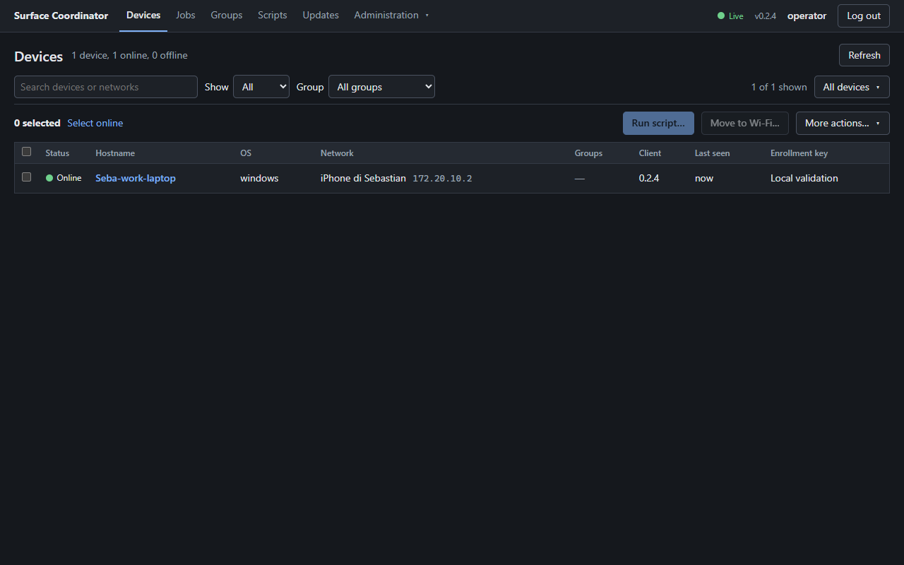
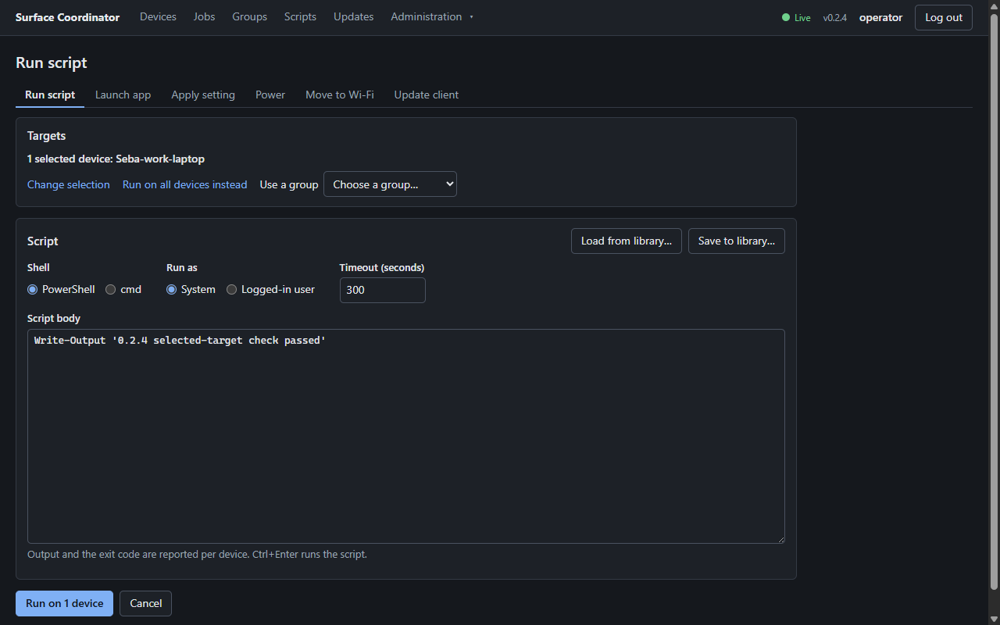
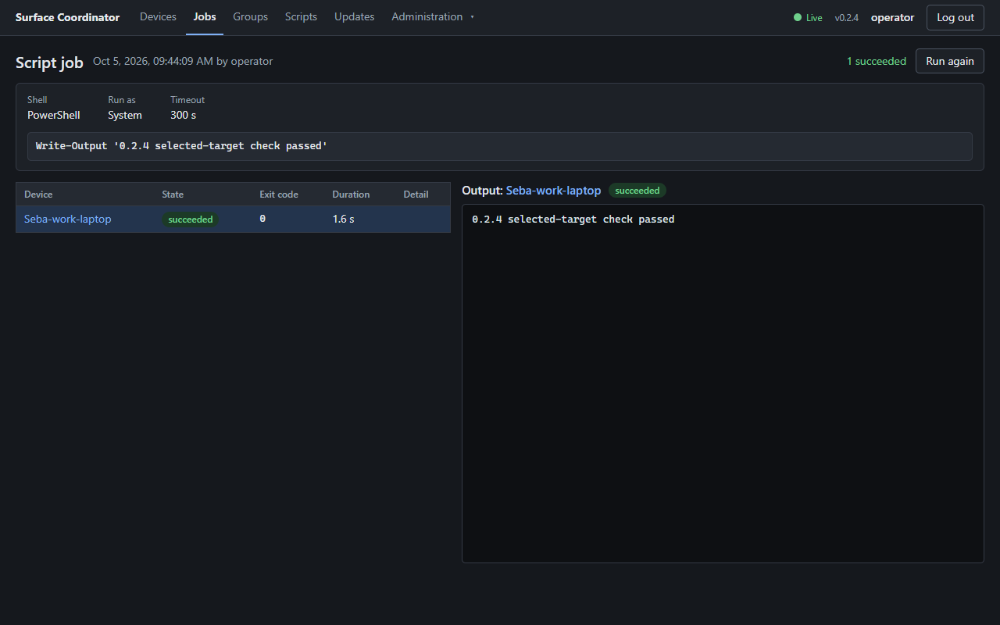
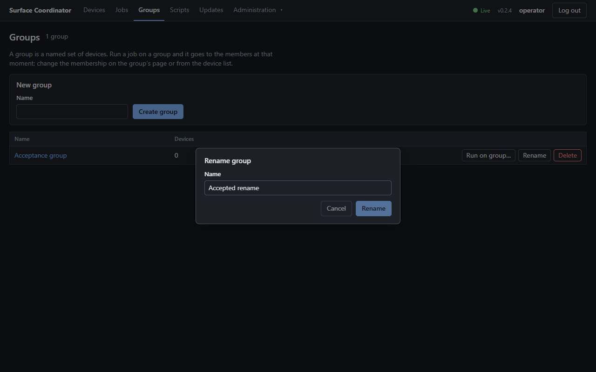
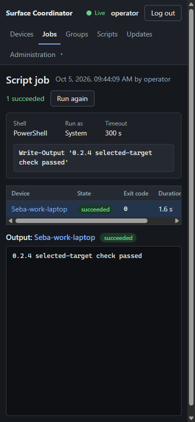
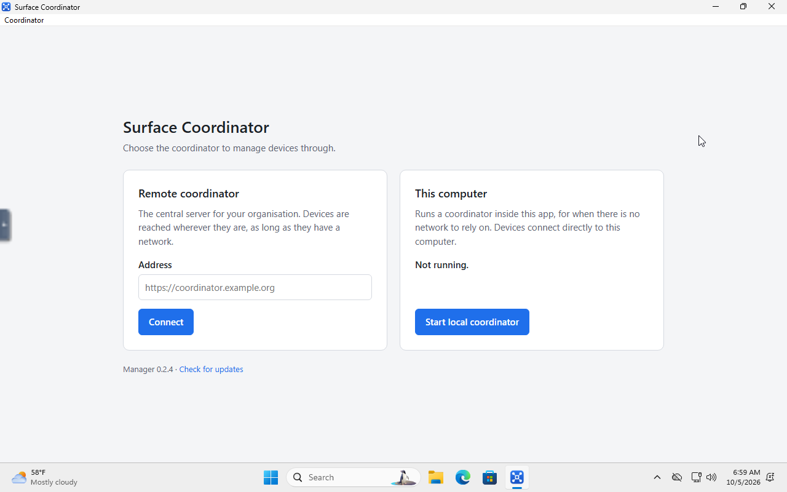
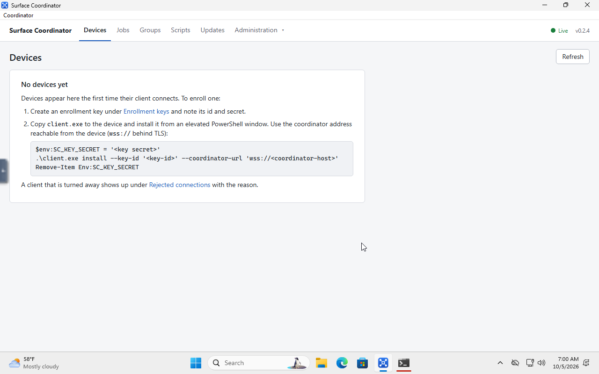
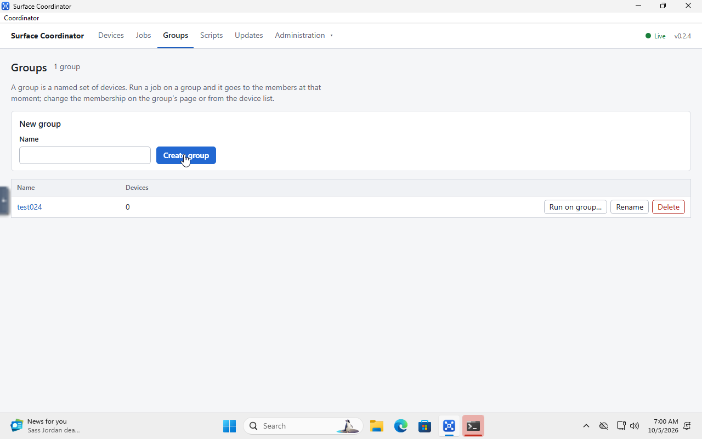
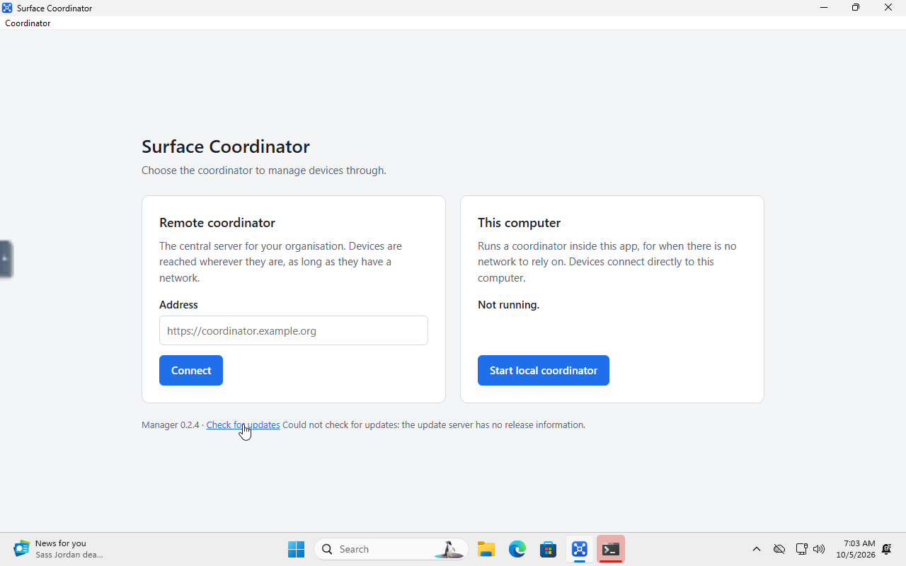

# Version 0.2.4 validation

Release acceptance passed for the local 0.2.4 bundle. The four audited defects
and two additional issues found during review and native testing are fixed.
The checks and remaining test boundaries are recorded below.

Execution host: **Seba-work-laptop**, checkout `C:\coding\surface-coordinator`.
Native Windows tests use the disposable **SC-VALIDATION** VM. Linux tests use
isolated Docker containers and volumes. The live coordinator and installed
physical Surface clients are outside this release test environment.

## Fixes

| Audit finding | Change | Verification |
|---|---|---|
| UI-01: selected devices became all devices after opening a library script by name | Preserve target selection through script inspection, editing, duplication and return navigation | Three navigation regressions; real browser captured an explicit single-device POST and successful output |
| UI-02: pending writes could be dismissed as if cancelled | Password, rename, membership and save-to-library dialogs block Cancel, Escape, backdrop dismissal and field changes until the write settles | Five focused pending/error/retry tests; real delayed rename remains open and then saves once |
| WIN-01: installed-service CMD scripts failed on canonical Windows paths | Convert verified disk/UNC paths only for CMD invocation, check they still address the same file, remove CALL's second expansion and disable delayed expansion | CMD helper tests include spaces, Unicode, literal percent, ampersand and exclamation mark; actual installed-service checks below |
| WIN-02: rejected sleep was reported as successful | Preflight supported sleep states and report success only after the native call returns; report Windows errors as failed jobs | Native-failure and interrupted-recovery tests; actual VM results below |
| Related power cancellation issue found during review | Preserve unresolved in-flight power results when cancellation occurs offline or before disconnection | Tests cover sent/running targets, all power actions, reconnect, coordinator restart, old cancellation replay and final success/failure. Queued power still cancels immediately |
| Custom service path defect found during native acceptance | Reject percent signs in resolved install/state paths before permission, file or service changes; keep uninstall able to remove older installations | Focused tests cover defined/undefined variable syntax and lone percent signs in either directory; final native refusal and cleanup checks below |

Restart/shutdown success means Windows accepted a scheduled action with a five-second
delay. Sleep remains running until the native call completes after resume. A client
restart before completion reports interruption and does not repeat the action.

No durability or batching constants were changed to chase the earlier fleet timing.
The identical shipping 0.2.3 coordinator drained the same 54,000 output chunks in
**589 ms maximum** on a quiet host, compared with 20,341 ms during VM provisioning.
Resource contention is a plausible explanation, not a measured attribution to one
specific CPU or disk bottleneck. Final 0.2.4 measurements follow below.

## Final checks

| Check | Final result |
|---|---|
| Windows Rust workspace | 559 passed, 0 failed; 2 opt-in hardware tests ignored |
| Windows Clippy, workspace/all targets | Passed with warnings denied |
| React UI | 391 tests passed across 27 files; TypeScript and production build passed |
| Manager launcher | 7 tests passed |
| Manager packaging boundaries | 22 checks passed |
| Installed Windows Manager | NSIS installation succeeded; installed payload hash matched; launcher/local coordinator, group creation, stop/restart persistence and close passed in the disposable VM |
| Installed Windows client lifecycle | 48 checks passed: service install/reinstall, System and interactive execution, signed 0.2.3 → 0.2.4 update, signature/replacement refusals, rollback, identity preservation and uninstall |
| Linux default workspace | 389 passed, 0 failed, 0 ignored |
| Local release integration | 7 checks passed with a real Windows console client: authentication, execution/output, cancellation, offline queue/reconnect, running-job recovery after coordinator restart |
| Embedded release browser | Single-device library navigation and delayed rename fixes passed against the final coordinator; 390px job layout has no page overflow |
| Linux deployment rehearsal | 33 checks passed: shipping 0.2.3 → 0.2.4, stopped-server backup, restore to 0.2.3, preserved accounts/session/enrollment/group/script/output/device identity |

Linux validation also checked the exact embedded UI assets, an unprivileged
runtime user (UID 10001), HTTP health, the native binary and exported image.
Restoring the old backup removed changes made after the upgrade, as expected.
That server rehearsal used the 0.2.4 console client before the Windows install-path
guard was added. The final signed client was then retested separately through
local integration, the browser and the full installed-service acceptance.

The ignored Windows unit tests require opt-in before changing actual audio
settings or scanning Wi-Fi. They are not counted as passes. Performance and
native VM checks use separate fixtures and are listed below.

## Final fleet performance

The final Windows coordinator ran with **300 synthetic authenticated devices**,
the VM paused and no competing compiler jobs. Existing desktop background
processes remained. These are measurements on this host, not a network latency guarantee.

| Measure | Result |
|---|---:|
| Short-job targets | 4,500 |
| API requests / failures | 843 / 0 |
| API p95 / p99 | 68.43 / 115.75 ms |
| Streaming chunks / bytes | 54,000 / 27,648,000 |
| Acknowledged streaming targets | 300 / 300 |
| Result drain p95 / maximum | 988 / 990 ms |
| Unexpected device disconnects | 0 |
| Maximum coordinator RSS | 75.80 MiB |

Output was checked byte for byte through the API and event stream. Results and
output survived coordinator termination, and SQLite `quick_check` passed.
Cancellation, reconnection and duplicate suppression also passed. The quiet
0.2.3 baseline was faster (589 ms maximum drain; 28.36 ms API p95), so these
results do **not** establish a speedup over 0.2.3. They establish correct,
subsecond result draining in this final workload, without VM provisioning load.

## Native Windows acceptance

The real service updated from shipping 0.2.3 to the exact signed 0.2.4 executable.
It reconnected with the same device identity and executed another script.
Invalid signatures and Windows file-sharing locks were rejected without losing
the previous working executable. Both startup-count rollback and the production
confirmation deadline passed; the latter restored the baseline after **180.416
seconds** with one unconfirmed start. These rollback scenarios injected a pending
marker and backup after a successful update. They do not establish recovery from
every possible crash during executable replacement.

The installed Manager matched the verified NSIS payload byte for byte. It created
a group through its embedded coordinator and preserved it across stop/start.
Closing removed its process and local listener; uninstall returned exit code 0
and removed the installed executable. Its public update check correctly reported
that no release information is available.

The final client's additional native checks passed:

| Check | Result |
|---|---|
| Install-path guard | 8 checks: defined/undefined variable syntax and lone percent signs refused in either directory; existing service, executable and parent permissions unchanged; older percent-path installation still removable |
| CMD and rejected power actions | 8 checks: System and logged-in user execution, success and exact exit-7/output/identity through a canonical path containing spaces, Unicode and shell metacharacters; unsupported sleep fails; Windows error 1190 becomes a failed job; owned shutdown timer aborted and subsequent CMD succeeds |
| Actual restart | Windows accepted the job, the guest rebooted, the same device/service returned automatically, the successful result persisted and a new CMD job succeeded |
| Actual shutdown and cold start | Windows accepted the job, the VM powered off with container exit 0, then the same disk booted; service, device identity, result and subsequent CMD execution all recovered |

The VM has no supported hardware sleep state, so it proves correct rejection,
not successful physical sleep/resume. Its clock lagged the host by roughly seven
minutes. Recovery checks used changed guest boot identities, Windows events and
VM power state; rollback duration used elapsed time within the guest. Host and
guest timestamps should not be subtracted to infer latency.

Cleanup passed. The guest's test service, tasks, Manager process/rule and fixture
listeners were removed first. The owned VM/container and disk volume, downloaded
ISO and temporary guest credential file were then removed; port 18146 is closed.
The local browser fixture, fleet fixture and deployment rehearsal were also
stopped and their cleanup recorded. Retained diagnostic evidence is excluded
from delivery unless explicitly listed in the sanitized release manifest.

## Scope and release status

The client and Windows Manager packages carry verified update signatures. Those
signatures are separate from Windows Authenticode; these Windows installers are
not Authenticode-signed. The Linux native binary requires glibc 2.36 or newer;
the supplied Docker image includes the compatible runtime.

This is a local bundle. It has not been published to GitHub or deployed to the live
coordinator. At the release audit, the repository had no releases and both public
update feeds returned 404. Signed client upload and manual installation work without
a public release. Manager update discovery needs publication. The standalone
coordinator does not self-update; Manager updates include its embedded coordinator.

The tag workflow publishes a shared latest release after its builds pass. It does
not provide a canary-only channel. Turn off an existing coordinator's automatic
rollout before uploading a build intended only for a chosen test device.

Fresh physical Surface Wi-Fi transfers, hardware sleep/resume, macOS/Linux Manager
installers, external HTTPS/proxy deployment and a long-duration production soak
are not established by these isolated Windows/Linux checks. Earlier physical
results remain in the 0.2.3 audit and are not counted as fresh 0.2.4 tests.

## Screenshots

These show the real embedded 0.2.4 interface with isolated test data, not mockups.

The following screenshots show the installed Windows Manager inside SC-VALIDATION.

## Evidence

The final bundle's `evidence/` folder contains sanitized reports, test logs,
source hashes and artifact hashes. `SHA256SUMS.txt` covers the delivered payload;
the archive is read back and checked against the frozen input hashes. Private
signing keys, enrollment credentials, raw configuration and database backups
are excluded from the explicit delivery allowlist.

| Evidence in the bundle | Contents |
|---|---|
| `windows-build.json`, `rust-tests.log`, `clippy.log` | Final Windows artifacts, complete test results and warning-free lint run |
| `client-build.log` | Final signed client's release build after service-path preflight was added |
| `manager-package.log`, `manager-package-tests.log` | UI/launcher tests and package boundary checks |
| `power-cancellation-tests.log` | Focused power-result and cancellation coverage |
| `linux-tests.json`, `linux-test-provenance.json`, `linux-image.json` | Linux tests, exact build inputs, embedded assets and final image identity |
| `release-integration.json`, `browser-report.json` | Real console-client integration and final embedded-interface acceptance |
| `server-upgrade-restore.json` | Deployment upgrade, stopped-server backup and old-version restore rehearsal |
| `performance-baseline.json`, `fleet-final.json` | Quiet 0.2.3 comparison, final 300-device measurements and fixture cleanup |
| `client-signatures.json`, `manager-signatures.json`, `client-pe-imports.json` | Signature acceptance/rejection, installer payload identity and runtime dependencies |
| `source-manifest.json`, `release-metadata.json` | Hashes of 207 source inputs, artifact signing status and delivery scope |
| `release-workflow-readiness.json` | Read-only publication audit and constraints of the existing tag workflow |
| `browser-cleanup.json` | Final local integration processes stopped and temporary access file removed |
| `manager-install.json`, `manager-ui.json` | Exact installed Manager payload and desktop UI acceptance |
| `client-lifecycle.json`, `client-rollback-deadline.json` | All 48 installed-service checks and measured production rollback timeout |
| `native/native-summary.json`, `native/evidence/` | Exact native artifact identities, path guard, CMD/error results, real reboot/shutdown recovery, Manager cleanup and removal of the disposable VM |

The source manifest identifies the tested working tree, which includes earlier
uncommitted project work. A later CI rebuild needs its own artifact verification;
these results identify the binaries in this local bundle.

The last change affects only Windows client installation path validation. The
client was rebuilt and re-signed, and its Windows tests and native acceptance
were repeated. Coordinator, Manager, Linux and embedded UI artifacts retain the
same verified hashes from their completed checks.
